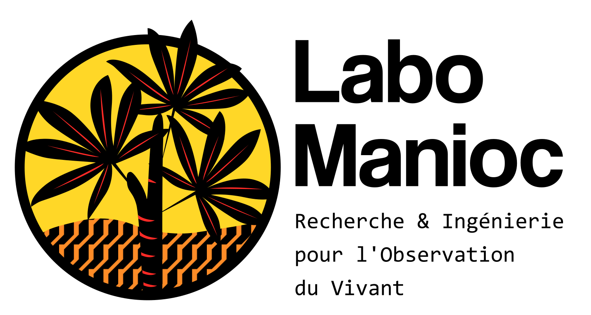

## Présentation

Chercheur indépendant spécialisé dans l’analyse, la conception et le développement de solutions matérielles et logicielles dédiées à l’observation du vivant.

## Domaines d’intervention

### Électronique embarquée

- Conception de cartes électroniques
- Développement de firmware
- Aide à la définition du cahier des charges

### Réseaux de capteurs

- Mise en réseaux de capteurs intelligents.
- Définition des protocoles de communication (Satellite, LTE, LoRaWAN, …).
- Collecte et mise en base des données.

### Traitement et analyse de données

- Post-traitement de jeux de données
- Automatisation de scripts d’analyse et rapports.
- Etudes détaillées ou exploratoires.

### Suivi de projets R&D

- Etude de faisabilité.
- Conseil et expertise.
- Gestion des sources (archivage, versionnage, documentation)

### Valorisation scientifique

- Aide à la rédaction de manuscrit pour des groupes de travail, des congrès ou des journaux scientifiques.
- Conception de démonstrateurs pour des interventions auprès du grand public

