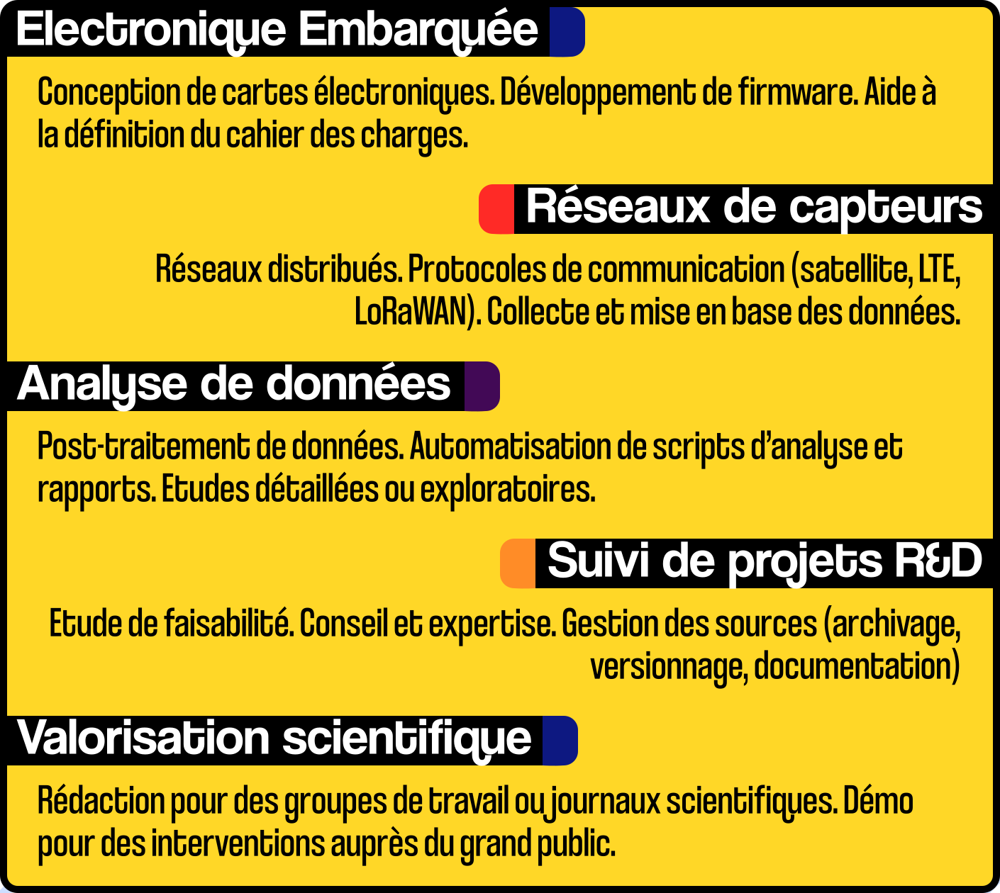

---

**Chercheur indépendant spécialisé dans l’analyse, la conception et le développement de solutions matérielles et logicielles dédiées à l’observation du vivant.**

Contact : Dr. Mohan JULIEN (Labo Manioc)

Domiciliation : Saint-Leu, La Réunion, France.

Email : mohanjulien@gmail.com

Website : https://labo-manioc.github.io/

Github : https://github.com/labo-manioc 

